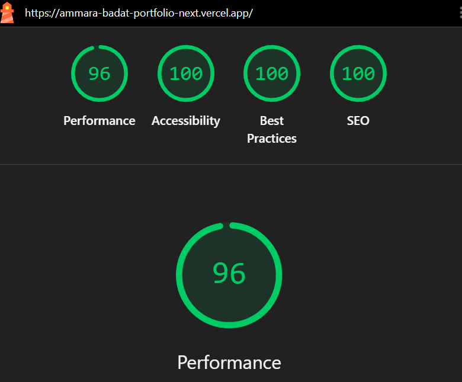

# Ammara Badat — Portfolio

**Live site:** https://ammara-badat-portfolio-next.vercel.app

## Who this site is for
Recruiters, hiring managers and tech leads at South African software teams and agencies
who are hiring junior developers, plus anyone reviewing my work from the
IT Programming (ITProg26) course at Unicollege, Krugersdorp.

## The role I want
**Junior Full Stack Developer**: building complete web applications from interface to database.

- **Front end:** HTML, CSS and JavaScript, plus React and Next.js, building responsive, interactive interfaces
- **Back end and data:** SQL and Supabase (Auth, Row Level Security)
- **Tools:** Git and GitHub, Vercel and AI prompting
## Tech stack
Next.js (App Router) · React · TypeScript · Tailwind CSS · Supabase (Postgres, Auth with two-step sign-in,
Row Level Security, Storage, Realtime) · Vitest and GitHub Actions · deployed on Vercel

## Project structure
```
app/         Pages and API routes (each folder is a web address)
components/  Reusable building blocks (Navbar, ContactForm, Inbox, TwoStep, ...)
content/     My words: about, case study, skills, certifications, dev notes, CV
lib/         Supabase connection, SEO, theme, project loading and small tested helper functions
public/      Screenshots, certificates, CV PDF, demo video, icons
Supabase/    The SQL files, run in order (schema.sql, then 003 to 009)
tests/       Vitest tests (npm test)
e2e/         Browser tests with Playwright (npm run test:browser)
Docs/        Wireframes, proof screenshots and the code guide (how-it-works.md)
```

## Wireframes
- [Home](Docs/wireframe-home.png)
- [Projects](Docs/wireframe-projects.png)
- [Contact](Docs/wireframe-contact.png)

## Milestones, upgrades and what the site has now
Everything I built, in one place. Each part has a label:

| Label | Meaning |
|---|---|
| 🏁 **Milestone** | The course milestones for the final project (weeks 32 to 38) |
| ⬆️ **Upgrade** | Extras I added on top of the milestones, in the order I built them |
| ✅ **Now** | What the live site does today, grouped by area |

The proof for each part (tables, tests and screenshots) is in [Details and proof](#details-and-proof) further down,
and my reflection for each milestone is in the [`Reflections/`](Reflections) folder.

### 🏁 Milestones

#### 🏁 Milestone 1: Plan, set up and deploy
- Chose my audience (South African recruiters and tech leads) and my target role (Junior Full Stack Developer).
- Drew wireframes for [Home](Docs/wireframe-home.png), [Projects](Docs/wireframe-projects.png) and [Contact](Docs/wireframe-contact.png).
- Started a Next.js app with TypeScript and Tailwind CSS, split my old one-page portfolio into separate
  pages (Home, About, Projects, Contact) with a shared navbar, and deployed it to Vercel.
- Peer review: a classmate said the site stands out but has a lot of colour and animation, which led to
  the animations switch I added later ([Reflections/Peer review.txt](Reflections/Peer%20review.txt)).

#### 🏁 Milestone 2: Database and security
- Created the `projects` table in Supabase, and the Projects page now loads from it instead of text in the code.
- Turned on Row Level Security with four policies: anyone can read, only my account can add, edit or delete.
- Built an owner-only `/admin` page with sign-in, where I can add, edit and delete projects.
- Proved a signed-out visitor can't change anything ([see the test](#how-i-proved-a-visitor-cannot-write)).

#### 🏁 Milestone 3: Case study, About and Skills
- Wrote a case study of my capstone (Family Clinic Platform) with screenshots and a demo video,
  with my private details blurred.
- Wrote an About page that explains who I am in about 30 seconds, and added my certifications with an image viewer.
- Built a Skills page where every skill links to proof (a file, a commit or a live page).
- Restyled the site to match my first portfolio, and added animations, icons, a 404 page and a share preview.

#### 🏁 Milestone 4: Contact form, CV and accessibility
- Contact form saved to a `messages` table, with spam protection: a hidden honeypot field, a speed check and a
  rate limit inside the database ([details](#contact-form)).
- An inbox on `/admin` that only my account can read.
- One-page CV download.
- Checked every page at 360, 390, 768, 1024 and 1440px, with the keyboard, and for WCAG AA contrast
  ([details](#responsive-and-accessibility-checks)).

#### 🏁 Milestone 5: SEO, Lighthouse and profile links
- Lighthouse on mobile: **Performance 96, Accessibility 100, Best Practices 100, SEO 100**
  (Performance started at 74, [here's how I fixed it](#lighthouse-scores-mobile)).
- Every page has its own title, description, canonical URL and share image, plus a sitemap and robots.txt.
- GitHub and LinkedIn linked from the site, and my site linked from LinkedIn ([details](#profile-links)).

#### 🏁 Milestone 6: Video walkthrough and final README
- A 3-minute silent video walkthrough with short captions: who I am, a tour of the site, the capstone
  case study, and how Supabase is used (two-step sign-in, RLS, drafts, the live inbox)
  ([watch it](#video-walkthrough)).
- This README, written so someone new can set the site up from scratch ([Setup](#setup-run-it-yourself)),
  with the [environment variable names](#environment-variables), my [use of AI](#use-of-ai) and the
  [known gaps](#known-gaps), and my [reflection](#reflection-another-two-weeks).
- A [secrets check](#secrets-check) of the files and the whole git history.

### ⬆️ Upgrades
Extras beyond the milestones, in the order I built them.

| # | ⬆️ Upgrade | When | What it added |
|---|---|---|---|
| 1 | Upgrade pack 2 | After Milestone 4 | Interactive terminal, spotlight cards, project filters, image viewer, screenshot uploads to Supabase Storage, an admin overview with a chart, light and dark mode, sitemap, robots.txt and structured data |
| 2 | Milestone 5 upgrades | With Milestone 5 | A page for every project, faster images, live GitHub activity, Ctrl+K search, an installable site, Vercel Analytics and Lighthouse CI |
| 3 | Milestone 5 extras | With Milestone 5 | Google Search Console, dev notes with an RSS feed, page transitions, a "Save my contact" card with a QR code, and a Lighthouse badge |
| 4 | Mobile first | After testing on my phone | Fixed the tech marquee, light mode, animations, slow screenshots and the QR code on phones, without changing the desktop look |
| 5 | Feature pack | After Milestone 5 | Automated tests on GitHub, error, loading and empty states, drag-and-drop project order, the animations switch (from peer review), the web CV and the phone navigation bar |
| 6 | Reading and contact extras | After Milestone 5 | A reading progress bar on dev notes and a Copy email button |
| 7 | Live admin inbox | Admin upgrades | Messages appear live (Supabase Realtime), search, filters, Reply and Undo delete |
| 8 | Drafts and history | Admin upgrades | Drafts hidden by RLS, a live preview card, an activity log written by a database trigger, and auto sign-out |
| 9 | One-tab sign-in | Admin upgrades | The admin sign-in lasts for one tab and ends when the window closes |
| 10 | Two-step sign-in | Admin upgrades | An authenticator code after the password, enforced by the database (`aal2`) |
| 11 | Docs checks | Polish | Tests that fail if this README or the code guide fall behind the code |
| 12 | Dev note navigation | Polish | Heading links and Older / Newer note links |
| 13 | Updated dates and back to top | Polish | "Updated" dates on changed dev notes, and a back-to-top button |
| 14 | Back, Forward and Refresh | Polish | Browser-style buttons on the site itself, and GitHub Actions updated to Node.js 22 |
| 15 | Faster Lighthouse checks | Polish | Lighthouse starts as soon as Vercel is serving the new commit, runs once per page, and skips document-only changes |
| 16 | Download messages as CSV | Admin upgrades | A "CSV" button in the inbox that saves the messages being viewed as a spreadsheet file, protected against formula tricks |
| 17 | Activity log for messages and images | Final project | The activity log also records new and deleted messages and uploaded and deleted images, with All / Projects / Messages / Images buttons |
| 18 | Real 404s and activity counts | Final project | A wrong project address now returns a real 404 (not a 200 page saying "not found"), and the activity filter buttons show how many entries each kind has |
| 19 | Security headers and a tab badge | Final project | Browser protections on every page (no framing by other sites, no type guessing, https only, unused features switched off), and a number badge on the admin tab icon for unread messages |
| 20 | Copy code and unsaved changes | Final project | A Copy button on every code example in the dev notes, and a warning before I lose typing in the admin project form |
| 21 | Contact draft and copy link | Final project | The contact form keeps what a visitor typed if they refresh, and project pages and the case study have a Copy link button |
| 22 | Browser tests and Show password | Final project | Playwright tests that click through the live site as a laptop and a phone after every deploy, and a Show / Hide button on the admin password box |
| 23 | Currently building | Final project | A section under my projects for apps I'm building (now TickList and Recall), which disappears when they're live |
| 24 | Live project count | Final project | The "Projects built & shipped" number on the About page is counted from Supabase, so it goes up by itself when I publish a project in `/admin` |
| 25 | Four small additions | Final project | A Mark all read button in the admin inbox (one request, with Undo), a Filter by topic row on the Dev notes page with counts and shareable links (`/notes?tag=Security`), related notes at the end of every note, and my local time on the Contact page |

### ✅ What the site has now

#### ✅ Pages
| Page | Route | What it shows |
|------|-------|---------------|
| Home | `/` | Intro, role, "open to work" status and a code card, with links to Projects and Contact |
| About | `/about` | A 30-second intro: who I am, the role I want, my education (ITProg26, Unicollege), my 4 Certiport certifications, and a stats row whose project count is counted live from Supabase (`lib/stats.ts`) |
| Projects | `/projects` | Project cards loaded live from Supabase, each with a screenshot, tags and live/GitHub links. The capstone is shown first. Below them, a **Currently building** section for projects in progress (`content/currently-building.ts`) |
| Case study | `/projects/nextjs-dashboard` | Capstone case study: the problem, my role, the stack, a demo video, screenshots, live and repo links, and what I'd do next |
| Skills | `/skills` | Every skill linked to evidence: a file in a repo, a commit or a live page |
| Project pages | `/projects/neon-arcade` etc. | One page per project, built from Supabase, with breadcrumbs, a **Copy link** button for sharing, and "More projects" |
| Dev notes | `/notes` | Short posts about what I built and learned, with a **Filter by topic** row, **related notes** at the end of each note and an [RSS feed](https://ammara-badat-portfolio-next.vercel.app/notes/rss.xml) |
| Contact | `/contact` | Contact form (saved to Supabase, spam-protected), my local time in Johannesburg (and the visitor's, if different), email, phone, GitHub, LinkedIn, CV download, "Save my contact" card and QR code |
| CV | `/cv` and [`/cv/Ammara-Badat-CV.pdf`](public/cv/Ammara-Badat-CV.pdf) | My CV as a web page that prints cleanly, plus a one-page PDF download, linked from the navbar, Home, About and Contact |
| Admin | `/admin` | Owner-only: sign in, a live inbox for contact form messages (search, filters, reply, undo delete, download as CSV), drafts, a live preview, an activity log, two-step sign-in with an authenticator app, a sign-in that ends when the tab closes, auto sign-out, add, edit and delete projects, upload screenshots and drag projects into order (not linked in the navbar) |

#### ✅ Admin and security
| Feature | What it does |
|---|---|
| Owner-only admin | Add, edit and delete projects, upload screenshots to Supabase Storage, and drag projects into order (mouse or finger, or ↑/↓). RLS makes sure only my account can change anything. |
| Two-step sign-in | After the password, `/admin` asks for a 6-digit code from an authenticator app (TOTP, set up once with a QR code). Every owner RLS policy uses `public.is_owner()`, which needs my user ID **and** an `aal2` login token, so a guessed password alone can't read or change anything, even through the API (`components/TwoStep.tsx`, `Supabase/008-two-step-sign-in.sql`). The password box has a **Show** / **Hide** button, and the password is hidden again as soon as I press Sign in. |
| One-tab sign-in | The sign-in is kept in `sessionStorage`, not `localStorage`, so it belongs to one tab: `/admin` always opens on the sign-in form, a new tab, window or person gets the sign-in form, and closing the window signs me out. A closed tab reopened later is signed out too (`lib/admin-session.ts`). |
| Auto sign-out | After 30 minutes without activity, `/admin` signs me out, with a 60-second "Still there?" warning first (`components/IdleSignOut.tsx`). |
| Live inbox | New contact messages appear straight away with a "New message from …" pop-up, using Supabase Realtime (`Supabase/006-realtime-inbox.sql`). Realtime follows RLS, so only my account receives them. The tab title shows the unread count and the tab icon gets a number badge (`components/TabIconBadge.tsx`), there's search and All / Unread / Read filters, **Mark all read** (with Undo), Reply quotes the message, and Delete can be undone for 5 seconds (`components/Inbox.tsx`). |
| Drafts | A Live / Draft switch on every project. The read policy lets visitors see only published projects, so a draft can't be seen even through the API (`Supabase/007-drafts-activity-log.sql`). |
| Live preview | While adding or editing a project, the real Projects page card updates as I type. It's `inert`, so its links can't be clicked by accident. |
| Unsaved changes warning | Once I've typed in the project form, "Unsaved changes" shows next to the buttons, and leaving asks first: the browser's "Leave site?" box when closing or refreshing, and a "Leave without saving?" box when clicking a link, editing another project or signing out (`components/UnsavedChangesGuard.tsx`, `lib/unsaved.ts`). |
| Activity log | Database triggers record every project added, edited, published, moved to drafts, reordered or deleted, every message that arrives or is deleted, and every image uploaded or deleted. It is shown as a live timeline with All / Projects / Messages / Images buttons, each showing how many recent entries it has. Only my account can read it, and there are no write policies, so entries can't be faked or deleted from a browser (`components/ActivityLog.tsx`, `Supabase/009-activity-log-messages-images.sql`). |
| Download CSV | A **CSV** button in the inbox saves the messages I'm viewing (after search and filters) as a spreadsheet file that Excel and Google Sheets open. It's built in the browser, so nothing is sent anywhere. Messages come from a public form, so any cell starting with `=`, `+`, `-` or `@` gets a `'` in front, which stops a spreadsheet running it as a formula ("CSV injection") (`lib/csv.ts`). |
| Overview | Cards for projects, drafts, unread messages and messages this week, plus a 7-day bar chart. |
| Security headers | Every page and file is sent with browser protections: other sites can't show my pages in a frame, files are never run as the wrong type, https is always used, and features I don't use (camera, microphone, location, payments) are switched off ([details](#security-headers)). |

#### ✅ Contact
| Feature | What it does |
|---|---|
| Contact form | Saves to Supabase, protected from spam by a hidden honeypot field, a speed check and a rate limit inside the database ([details](#contact-form)). |
| Draft kept on refresh | If a visitor refreshes or goes Back by accident, what they typed in the contact form is still there, with a "Start over" button. It's kept only in that browser tab (`sessionStorage`), is never sent anywhere until they press Send, and is deleted once sent or when the tab closes. The hidden spam field is never saved (`lib/contact-draft.ts`). |
| Copy email | A **Copy** button on my email. One tap copies the address and shows "Copied!", which helps people who use webmail (`components/CopyEmail.tsx`). |
| Save my contact + QR code | A vCard file (`/ammara-badat.vcf`) that adds me to a phone's contacts in one tap, and a QR code that opens the site. |
| CV | A web CV at `/cv` that prints cleanly, and a one-page PDF download. |

#### ✅ Design, accessibility and mobile
| Feature | What it does |
|---|---|
| Light / dark mode | Sun/moon button. The choice is saved in `localStorage` and applied before the page paints, so there's no flash. Every colour was checked for WCAG AA contrast in both themes. |
| Animations switch | Added after peer review (a classmate found the site busy): turn animations off in the top bar, in Ctrl+K or with the terminal's `motion` command. Devices that ask for less motion always get it. |
| Mobile first | Checked at 360 to 1440 pixels wide and on my own phone. A phone navigation bar at the bottom (Home, Projects, Search, Notes, Contact) always stays in place. |
| Back, Forward and Refresh | Browser-style buttons next to my name on laptops and desktops, and at the top of the phone menu. They matter most when the site is installed on a phone's home screen, where there is no browser bar. Back and Forward grey out when there's nowhere to go (`components/NavArrows.tsx`, `lib/nav-arrows.ts`). |
| Back to top | On long pages, a small arrow appears after scrolling down, jumps back to the top and moves keyboard focus there. It sits above the phone navigation bar and is hidden on the admin page (`components/BackToTop.tsx`). |
| Interactive terminal | The `developer.ts` card on Home takes commands: `help`, `about`, `skills`, `projects`, `certs`, `contact`, `cv`, `open <page>`, `theme`, `motion`, `clear`. ↑/↓ repeat commands, Tab finishes a word, and quick buttons work on phones. |
| Ctrl+K search | Search every page, project, skill, note and certificate, or download my CV, from anywhere. |
| Project filters | Filter projects by tech. The choice is kept in the address (`?tag=Next.js`) so it can be shared, and cards slide into place with the View Transitions API. |
| Image viewer | A full-screen viewer for certificates and screenshots, built on the native `<dialog>`: Escape closes it, focus is trapped and returns to the button, arrow keys and swiping move between images. |
| Spotlight cards and page transitions | A glow follows the mouse on cards (`components/Spotlight.tsx`, nothing on touch screens), and a red-to-teal stripe sweeps across the top on every page change (`app/template.tsx`). |
| Error, loading and empty states | A branded "Pit stop" page with **Try again** if a page fails (`app/error.tsx`), loading skeletons, and friendly messages if Supabase is down or there are no projects yet. |
| Real 404s | A wrong address, including a project that doesn't exist (`/projects/made-up`), returns a real **404** status and my "Off the track" page (`app/not-found.tsx`). The Projects loading skeleton sits in a route group (`app/projects/(list)/`) so it can't turn a missing project into a 200. |
| Installable | A web app manifest and icons, so the portfolio can be added to a phone's home screen. |

#### ✅ Dev notes
- **25 dev notes** about what I learned (Row Level Security, spam, Lighthouse, testing on a phone, the navigation bar, the animations switch, automated tests, the live admin inbox, drafts with an activity log, a sign-in that ends when the tab closes, two-step sign-in, how my tests grew from 47 to 65, writing about security without helping attackers, keeping my docs honest, the Lighthouse check that never ran, how my tests grew from 65 to 83, one timeline for projects, messages and images, why my missing project pages said 200, security headers, small things that save people's work, keeping a visitor's message safe, testing my site like a real visitor, showing work in progress honestly, building PaperTrail with Firebase, and four small additions: Mark all read, topics, related notes and my local time).
- Short posts (twenty-five so far) (`content/notes.ts`), each with its own page, share image and structured data, plus an RSS feed at `/notes/rss.xml`. New notes are added to the sitemap, the feed and Ctrl+K search automatically.
- A reading progress bar, a **#** link on every sub-heading, **Older note** / **Newer note** links, an "Updated" date on notes I changed later, and a **Copy** button on every code example (`components/ReadingProgress.tsx`, `components/CopyCode.tsx`, `headingIds()`, `noteNeighbours()` and `updated` in `content/notes.ts`).

#### ✅ SEO and performance
| Feature | What it does |
|---|---|
| Lighthouse | **Performance 96, Accessibility 100, Best Practices 100, SEO 100** on mobile, with my latest scores as a badge in the footer ([details](#lighthouse-scores-mobile)). |
| Findable | Titles, descriptions, canonical URLs, share images, a sitemap, robots.txt and structured data on every page ([details](#findable-what-every-page-has)). |
| Google Search Console | The site is verified with Google and the sitemap is submitted. The verification code comes from the `GOOGLE_SITE_VERIFICATION` setting in Vercel (`app/layout.tsx`). |
| Faster images | Screenshots use Next.js `<Image>`: smaller WebP files in the size the screen needs, lazy loading, and no layout jumps. |
| Live GitHub activity | My six most recently updated repos on the Home page, cached for an hour. |
| Speed Insights and Analytics | Vercel's cookie-free visit counts and real visitors' loading times. |

#### ✅ Quality checks
| Feature | What it does |
|---|---|
| Automated tests | 117 checks in `tests/` (Vitest): project addresses, the contact form's spam rules and draft, every skill having evidence, every linked file existing, the dev notes and their heading links, older/newer links and updated dates, the back-to-top button, the back/forward buttons, the SEO helpers, the contact card, the Currently building list, the live project count on the About page, the dev notes topic filter and related notes, the local time on the Contact page, the reading progress bar, the admin inbox search, Mark all read, Reply link and CSV download (including formula protection), the activity log wording, filters and counts, no loading screen above the project pages (so they can return a real 404), the security headers on every page, the unread badge on the tab icon, the unsaved changes warning, the auto sign-out timer, the one-tab sign-in, the two-step sign-in steps, and docs checks (the dev note count, every SQL file listed in Setup, every file the docs mention existing, and every link inside the README working). A GitHub Action runs them on every push (`.github/workflows/tests.yml`). |
| Browser tests | 15 tests in `e2e/` (Playwright) open the live site in a real browser, as a laptop and as a phone, and click through it like a visitor: the contact form (the spam trap is hidden, a too-short message is stopped, the right details are sent, errors are shown, the draft survives a refresh), the contact API ignoring bots and explaining mistakes, the admin page showing only the sign-in form and the Show password button, every main page and its title, a real 404, the security headers and the phone menu. They never send a real message or sign in. A GitHub Action runs them after each deploy (`.github/workflows/browser-tests.yml`). |
| Lighthouse CI | Lighthouse runs on the live site as soon as Vercel has deployed each push that changes it, once per page ([details](#lighthouse-scores-mobile)). |
| Code guide | A plain-English guide to every part of the code: [Docs/how-it-works.md](Docs/how-it-works.md). |

Also: **4 Certiport IT Specialist certifications** (HTML and CSS, HTML5 Application Development, Software Development, JavaScript), each with a verification code, shown on the About page and as evidence on the Skills page.

## Details and proof
The tables, tests and screenshots behind everything above.

### Database
Three tables, plus Supabase Storage for images:

| Table | What it holds | Defined in |
|---|---|---|
| `projects` | My projects (below) | `schema.sql`, `003`, `007` |
| `messages` | Contact form messages ([details](#contact-form)) | `004` |
| `activity_log` | The history of every change to a project, message or project image, written only by database triggers | `007`, `009` |
| `storage.objects` | Screenshots uploaded from `/admin` ([details](#storage-security-rls-on-files)) | `005` |

The `projects` table, defined in [`Supabase/schema.sql`](Supabase/schema.sql):

| Column | Type | Purpose |
|--------|------|---------|
| `id` | uuid | Primary key |
| `title` | text | Project name (required) |
| `summary` | text | One-line description |
| `live_url` | text | Link to the live site |
| `repo_url` | text | Link to the GitHub repo |
| `image_url` | text | Screenshot (files live in `public/projects/`) |
| `video_url` | text | Optional demo video (the capstone's lives in `public/case-study/demo.mp4`) |
| `case_study_url` | text | Link to a case study page (set for the capstone) |
| `tags` | text[] | Tech used, shown as tags |
| `sort_order` | int | Order on the Projects page |
| `published` | boolean | `false` = draft, only visible to my account |
| `created_at` | timestamptz | When the row was added |

`video_url` and `case_study_url` were added in Milestone 3 by
[`Supabase/003-screenshots-video-case-study.sql`](Supabase/003-screenshots-video-case-study.sql),
and `published` by [`Supabase/007-drafts-activity-log.sql`](Supabase/007-drafts-activity-log.sql), which also
creates the `activity_log` table (the history shown in `/admin`).

### Content
The page text lives in the `content/` folder, separate from the code:
`content/about.ts` (About, Home and Contact), `content/case-study.ts` (capstone case study),
`content/skills.ts` (skills and their evidence links), `content/certifications.ts` (my certificates,
shown on the About page; the images are in `public/certificates/`), `content/notes.ts` (dev notes) and
`content/cv.ts` (the web CV at `/cv`). Every skill must have at least one evidence
link, or the site will not build, so I can't list a skill I can't back up.

### Security: Row Level Security
RLS is enabled on every table. On `projects` there are four policies:

| Policy | Who | Rule |
|--------|-----|------|
| Anyone can read published projects | `anon`, `authenticated` | `select` only if `published` is true, or if `is_owner()` (so I can see my drafts) |
| Owner can insert projects | `authenticated` | only if `is_owner()` |
| Owner can update projects | `authenticated` | only if `is_owner()` |
| Owner can delete projects | `authenticated` | only if `is_owner()` |

Screenshot: [Policies in Supabase](Docs/rls-policies.png) (taken before drafts were added, when the read
policy was "Anyone can read projects")

**`is_owner()`** (from `008-two-step-sign-in.sql`) is true only for my user ID **and** a two-step sign-in:
Supabase puts an assurance level in the login token, `aal1` for password only and `aal2` for password plus
the code from my authenticator app. A sign-in with only the password gets nothing, even through the API.
Before two-step sign-in, these rules checked my user ID alone.

`activity_log` has RLS too: only my account can `select`, and there are no insert, update or delete
policies, so only the database triggers can write to it. For messages, the log keeps only the sender's
name, never their email or message.

Public sign-ups are turned off in Supabase Auth, so mine is the only account. Even if another
account existed, the policies check my exact user ID and the two-step level, so "any signed-in user"
still cannot write.

#### How I proved a visitor cannot write
Signed out, in an incognito window, I used the public anon key from the browser console to try
every operation against the live database:

| Test | Result |
|------|--------|
| Read projects | ✅ Allowed, returned all projects |
| Insert a project | ❌ Blocked: `42501 new row violates row-level security policy` (401) |
| Update MyFlix's title | ❌ Blocked: 0 rows changed |
| Delete MyFlix | ❌ Blocked: 0 rows deleted |

Screenshot: [RLS test in the browser console](Docs/rls-test-console.png)

#### How I tested the admin security (drafts, activity log, two-step sign-in)
Before running `007` and `008` on Supabase, I ran every SQL file in order on a local PostgreSQL set up
like Supabase, and tested as a visitor, as another signed-in account and as me:

| Test | Result |
|------|--------|
| Visitor or another account reads a draft, even after trying to publish it | ❌ 0 rows |
| Visitor or another account reads the activity log | ❌ 0 rows |
| Anyone (me included) adds, changes or deletes log entries directly | ❌ `permission denied` |
| Me with only a password (`aal1`): read messages, drafts or the log | ❌ 0 rows |
| Me with only a password (`aal1`): add a project or upload an image | ❌ `violates row-level security policy` |
| Me with only a password (`aal1`): edit or delete a project or message | ❌ 0 rows changed |
| Me with the authenticator code (`aal2`): everything | ✅ Works |
| Another account with `aal2` reads messages | ❌ 0 rows |
| Visitor sends a contact message | ✅ Still works |
| Visitor sends a message, then I upload and delete an image and delete the message (`009`) | ✅ 4 log entries; a visitor still reads 0 rows and can't call the trigger functions |

I also tested the sign-in screens in a browser: a fresh visit, the QR set-up, a wrong code, a pasted
code with a space, the code step on the next sign-in, refreshing, a second tab and reopening a closed tab.

### Security headers
Headers are instructions sent with every response that tell the browser to be stricter. They're set in
[`lib/security-headers.ts`](lib/security-headers.ts) and added to every address in `next.config.ts`.
Anyone can see them in the browser's Network tab, so listing them gives nothing away.

| Header | What it does |
|---|---|
| `X-Frame-Options: DENY` and CSP `frame-ancestors 'none'` | Other sites can't show my pages inside a frame, which stops **clickjacking** (a real page hidden under a fake button). The first is for older browsers, the second for newer ones. |
| CSP `base-uri 'self'; form-action 'self'; object-src 'none'` | Nobody can change where my relative links point, forms can only send to my own site, and old plugins are blocked. |
| `X-Content-Type-Options: nosniff` | The browser never guesses a file's type, so a text file can't be run as a script. |
| `Referrer-Policy: strict-origin-when-cross-origin` | When a visitor follows a link to another site, only my domain is shared, not the full address. |
| `Permissions-Policy` | Camera, microphone, location, payments, USB and ad-topic tracking are switched off. |
| `Cross-Origin-Opener-Policy: same-origin` | A page opened from my site can't reach back into it through `window.opener`. |
| `Strict-Transport-Security` | Browsers always use https for my site for two years, even if someone types `http://`. |

There's deliberately **no** `script-src` rule: Next.js, my theme script and Vercel Analytics use inline
scripts, and a strict rule would need extra setup (nonces) or would quietly break the site. A test in
`tests/security.test.ts` checks every header is sent on every page and fails if a script rule is added
by accident. It's listed in [Known gaps](#known-gaps).

### Contact form
Messages from `/contact` are saved to a `messages` table, defined in
[`Supabase/004-messages-contact-form.sql`](Supabase/004-messages-contact-form.sql).

| Column | Type | Purpose |
|--------|------|---------|
| `id` | uuid | Primary key |
| `name` | text | Sender's name (1–100 characters) |
| `email` | text | Sender's email (checked format) |
| `message` | text | The message (10–3000 characters) |
| `ip_hash` | text | One-way hash of the sender's IP, used only for the rate limit (the IP itself is never stored) |
| `is_read` | boolean | Whether I've read it in `/admin` |
| `created_at` | timestamptz | When it was sent |

#### Who can do what (RLS)
| Policy | Who | Rule |
|--------|-----|------|
| Anyone can send a message | `anon`, `authenticated` | `insert` only, and it must arrive unread |
| Owner can read messages | `authenticated` | only if `is_owner()` |
| Owner can update messages | `authenticated` | only if `is_owner()` (mark as read) |
| Owner can delete messages | `authenticated` | only if `is_owner()` |

Visitors can add a message but can never read, change or delete one, including their own.
The inbox is on the `/admin` page, which only my account can use, after both sign-in steps.

#### Spam protection: honeypot + rate limit
I chose a **honeypot** and a **rate limit**, so real visitors never have to solve a CAPTCHA:

1. **Honeypot:** the form has a hidden "website" field that people never see and keyboard users
   can't reach. Bots fill in every field, so if it has a value the message is dropped.
2. **Speed check:** a person takes more than 3 seconds to fill in the form; bots submit instantly.
   Bots caught by 1 or 2 get a fake "sent" reply so they don't learn what gave them away
   ([`app/api/contact/route.ts`](app/api/contact/route.ts)).
3. **Rate limit in the database:** a trigger allows at most **3 messages per email address or per
   visitor every 10 minutes**, and 30 messages per hour in total. Because it runs inside Supabase,
   it also stops anyone who skips my form and calls the database directly.

#### How I tested it
Before running the SQL on Supabase, I tested it on a local PostgreSQL set up like Supabase:

| Test | Result |
|------|--------|
| Visitor sends a message | ✅ Saved |
| Visitor reads messages | ❌ 0 rows |
| Visitor marks as read / deletes | ❌ 0 rows changed |
| Visitor sends a bad email or a 2-character message | ❌ Rejected by the column checks |
| 4th message from the same email or visitor within 10 minutes | ❌ "Too many messages. Please try again in a few minutes." |
| Another signed-in account reads messages | ❌ 0 rows |
| My account reads, marks as read and deletes | ✅ Works |

The form itself: a filled-in honeypot or a 1-second submission is silently dropped, bad input shows a
friendly error, and the rate limit shows this message to the visitor:
[screenshot](Docs/contact-form-rate-limit.png).

### Storage security (RLS on files)
`Supabase/005-project-images-storage.sql` creates a public `project-images` bucket (images only,
5 MB max) and four policies on `storage.objects`:

| Who | View image by URL | Upload | List / replace / delete |
|---|---|---|---|
| Visitor (anon) | ✅ | ❌ | ❌ |
| Another signed-in user | ✅ | ❌ | ❌ |
| My account (owner) | ✅ | ✅ | ✅ |

Since `008-two-step-sign-in.sql`, "my account" here also means `is_owner()` (my account with the
authenticator code). I tested the policies on a local Postgres copy: a visitor and another user were blocked with
"new row violates row-level security policy", a visitor listed 0 files, another user's delete
removed 0 rows, and only the owner could upload, rename and delete.

### Responsive and accessibility checks
Every page was checked at **360px and 390px (phones), 768px (tablet), 1024px and 1440px (desktop)**.

- **Layout:** no page scrolls sideways or cuts off text at any of those widths.
  [Home](Docs/responsive-home.png) · [Projects](Docs/responsive-projects.png) · [Contact](Docs/responsive-contact.png)
- **Keyboard:** every link, button and form field can be reached with Tab, in a sensible order, with a
  visible teal focus outline. A "Skip to content" link appears on the first Tab press, the phone menu
  closes with Escape, and the hidden honeypot field is skipped.
- **Contrast:** every piece of text was measured against its background and passes WCAG AA
  (4.5:1 for normal text, 3:1 for large text). Fixes: the dim grey went from `#63667a` (3.0:1) to
  `#868a9c` (4.7:1 or better), small red text uses a brighter red `#ff3b5c`, and the red buttons use
  white text (4.32:1 → 4.70:1). My racing red is kept for large headings, where it passes.
- **Worst layout bug fixed:** on phones the Home page scrolled sideways, because the long line in the
  `developer.ts` code card forced the hero column wider than the screen. I fixed it by limiting the
  grid column (`grid-cols-1` = `minmax(0, 1fr)`), letting the role line wrap, and making the code
  smaller on phones.
- **Re-checked:** after Upgrade pack 2 added light mode, every check was run again in **both** themes, and everything still passes.

### Lighthouse and SEO
#### Lighthouse scores (mobile)
| Page | Performance | Accessibility | Best Practices | SEO |
|---|---|---|---|---|
| Home | 96 | 100 | 100 | 100 |



**What Lighthouse flagged and how I fixed it:** My first mobile run scored 74 for Performance. The
load-in animations kept my heading and intro invisible for about 2 seconds (Largest Contentful Paint
3.4 s, Speed Index 5.1 s), and too much JavaScript ran at load (Total Blocking Time 550 ms). I made the
animations slide in without hiding the content, loaded the Ctrl+K search, image viewer and spotlight
effect only after the page appears, and cut the heading font from 4 weights to 2. Performance went
74 → 88 → 96.

Lighthouse also runs automatically: after every push to `main` that changes the site, a GitHub Action
(`.github/workflows/lighthouse.yml`) checks `/api/version` (`app/api/version/route.ts`) every 15 seconds until
Vercel is serving that commit, then runs Lighthouse once on each of six pages (Home, About, Projects, the case
study, Skills and Contact) and fails if Accessibility or SEO drops below 90. Pushes that only change documents
(like this README) skip it. See the **Actions** tab.

#### Findable: what every page has
- **Title and meta description** written for that page (`lib/seo.ts`), all under 160 characters.
- **Canonical URL**, so `/projects` and `/projects?tag=CSS` count as one page.
- **Open Graph and Twitter tags** with a share image made for each page
  (`opengraph-image.jpg` in each page folder). Every project page draws its own share image
  on the server (`app/projects/[slug]/opengraph-image.tsx`).
- **Sitemap** at [/sitemap.xml](https://ammara-badat-portfolio-next.vercel.app/sitemap.xml), which
  lists every page plus one page per published project from Supabase and one per dev note (with the date each note last changed).
- **robots.txt** at [/robots.txt](https://ammara-badat-portfolio-next.vercel.app/robots.txt), which
  keeps `/admin` and `/api` out of search results.
- **Structured data (JSON-LD)** describing me (Person, with my certifications), the website, each
  page's breadcrumbs, the projects and the case study, so Google can show richer results.

#### Profile links
- **GitHub:** linked in the footer, on the Contact page, in the Ctrl+K search and in the terminal
  (`github`), and listed in my structured data. The Home page shows my latest repositories live from GitHub.
- **LinkedIn:** [linkedin.com/in/ammara-badat](https://www.linkedin.com/in/ammara-badat) — linked in the footer,
  on the Contact page and in Ctrl+K search. My portfolio URL is on my LinkedIn profile (Contact info → Website and Featured).

## Environment variables
Set in Vercel (Settings → Environment Variables) and, for local development, in `.env.local`
(git-ignored). Values are never committed.

| Name | What it is |
|------|------------|
| `NEXT_PUBLIC_SUPABASE_URL` | Supabase project URL |
| `NEXT_PUBLIC_SUPABASE_ANON_KEY` | Supabase anon / publishable key (safe in the browser because RLS protects the data) |
| `GOOGLE_SITE_VERIFICATION` (optional) | The code from Google Search Console's "HTML tag" method, e.g. `abc123…` (only the code, not the whole tag). |
| `GITHUB_TOKEN` (optional) | A read-only GitHub token. Only raises the GitHub API limit for the "Live from GitHub" section. |

The Supabase service role / secret key is not used anywhere in this project.

## Setup (run it yourself)
You need Node.js 22 or newer, a free [Supabase](https://supabase.com) project and, to deploy, a
free [Vercel](https://vercel.com) account.

### 1. Supabase
1. Create a Supabase project.
2. **Create the owner account:** Authentication → Users → **Add user** (email and password). Copy the
   user's **UID**.
3. **Turn off sign-ups**, so nobody else can create an account: Authentication → Sign In / Providers →
   Email → switch off **Allow new users to sign up**.
4. In the SQL files in `Supabase/`, replace my UID (`ed0dcf97-9b0a-460e-8ab3-0d025847c218`) with yours.
   It is what makes the RLS policies "owner only".
5. Open the **SQL Editor** and run the files **in this order**:

| Order | File | What it creates |
|---|---|---|
| 1 | `schema.sql` | `projects` table, RLS (anyone reads, only the owner writes) and my starting projects |
| 2 | `003-screenshots-video-case-study.sql` | Video and case study columns, screenshot paths, capstone first |
| 3 | `004-messages-contact-form.sql` | `messages` table for the contact form, owner-only reading and the spam rate limit |
| 4 | `005-project-images-storage.sql` | `project-images` Storage bucket and owner-only upload policies |
| 5 | `006-realtime-inbox.sql` | Turns on Realtime for `messages`, for the live admin inbox |
| 6 | `007-drafts-activity-log.sql` | `published` column and "Anyone can read published projects" policy, the owner-only `activity_log` table and its trigger |
| 7 | `008-two-step-sign-in.sql` | `is_owner()` (my user ID + two-step sign-in) used by every owner policy. Run it after setting up your authenticator app in `/admin` (step 2 below) |
| 8 | `009-activity-log-messages-images.sql` | Adds messages and project images to the activity log (a `kind` column and two more triggers). Run it after `008` |

6. Check that two-step sign-in with an authenticator app is allowed: Authentication → Multi-Factor
   (or Sign In / Providers) → **TOTP** switched on. It is on by default.
7. Copy the **Project URL** and the **anon / publishable key** from Project Settings → API.

### 2. Run locally
1. Create `.env.local` in the project root (it is git-ignored):
```bash
NEXT_PUBLIC_SUPABASE_URL=https://your-project.supabase.co
NEXT_PUBLIC_SUPABASE_ANON_KEY=your-anon-key
```
   Use only the base URL, with nothing after `.supabase.co`.
2. Install and start:
```bash
npm install
npm run dev
```
3. Open http://localhost:3000. Sign in at http://localhost:3000/admin with the owner account.
   The first time, the admin page shows a QR code: scan it with an authenticator app (Google
   Authenticator, or Microsoft Authenticator → **Other account**) and enter the 6-digit code. After that,
   every sign-in asks for the code. Then run `008-two-step-sign-in.sql`.
   - The sign-in only lasts for that browser tab and ends when the window closes.
   - Lost the phone? In Supabase, Authentication → Users → your account → delete its MFA factor, then set
     up the new phone in `/admin`.
4. Run the tests with `npm test` (they also run on GitHub after every push; see the **Actions** tab).
5. Browser tests: `npx playwright install chromium` once, then `npm run test:browser`. They test the live
   site by default; to test your own copy, run `npm run dev` and then
   `BASE_URL=http://localhost:3000 npm run test:browser` (in PowerShell: `$env:BASE_URL="http://localhost:3000"; npm run test:browser`).

### 3. Deploy
1. Import the GitHub repo into Vercel.
2. Add the environment variables from the table above (Settings → Environment Variables).
3. Using your own address? Change `siteUrl` in `lib/site.ts` (used for the sitemap, share links and
   SEO tags) and the page addresses in `.github/workflows/lighthouse.yml`. My name, CV and project
   text are in the `content/` folder.
4. Deploy. Every push to `main` deploys again; the Tests action runs on every push, and the Lighthouse
   action waits until the new deploy is live, then checks the live site.

### How the code works
A plain-English guide to every part of the code is in [Docs/how-it-works.md](Docs/how-it-works.md).

## Secrets check
Before submitting, I checked that no keys, tokens or `.env` files are in the repo **or its history**:

- **Files:** no `.env` file has ever been committed. `.gitignore` covers `.env` and `.env*.local`.
- **History:** I searched every commit (not just the latest) for Supabase keys and secret keys,
  service role keys, JWT tokens, GitHub tokens, private keys and my Supabase project address. Nothing
  was found.
- **Screenshots:** the proof images in `Docs/` show no keys. The only ID visible is my user ID in the
  RLS policies, which is not a secret: it is already in the SQL files, and on its own it cannot sign
  in or change anything.
- **The anon key:** it is only in Vercel's settings and my own `.env.local`. It is safe in the browser
  because RLS decides what it can do, and the service role key is not used anywhere.
- **Dev notes:** the public dev notes use placeholders for user IDs and leave out exact limits and
  private addresses, so they don't help anyone attack the site.

## Known gaps
Things I know are missing or could be better:

- **No email alert for new messages.** I see them in the admin inbox (live), but only when I open it.
- **No backup codes for two-step sign-in.** If I lose my phone, I have to remove the old authenticator
  in the Supabase dashboard (see [Setup](#2-run-locally)).
- **Spam protection is basic.** A hidden honeypot field and a per-sender limit stop simple bots, but
  there is no CAPTCHA.
- **The database rules are not in the automatic tests.** I tested RLS by hand (as a visitor, signed in
  without two-step, and fully signed in) and on a local copy of the database; the 117 automatic tests
  cover the site's code and docs, not the live database.
- **The browser tests stop at the sign-in form.** They never sign in, so the dashboard itself (inbox,
  projects, activity log) is still checked by hand. Signing in from GitHub would mean storing my password
  and authenticator secret there.
- **Lighthouse CI checks six pages, one run each**, so a score can move a few points between runs.
- **Some things are hard-coded:** my user ID in the SQL files and my site address in `lib/site.ts`,
  so someone setting it up must change them (see [Setup](#setup-run-it-yourself)).
- **The CV PDF is made by hand**, so I have to remake it when my CV page changes.
- **No script rule in my Content Security Policy.** My security headers block framing, plugins and
  outside forms, but not inline scripts, because Next.js and my theme script need them. A strict
  script rule would need nonces (a new random code on every page load).
- **English only.**

## Use of AI
AI use was allowed for this project. I built this site with Claude (by Anthropic) as my AI pair
programmer, working in short rounds, one feature at a time:

1. **I decided what to build next**: each milestone, feature or fix, and how it should look and behave.
2. **Claude wrote the code** for it and explained how it works.
3. **I added each change to my project** in VS Code, ran the SQL in Supabase, set up the services and
   settings, committed it and deployed it to Vercel.
4. **I tested it on the live site and on my own phone** and reported what broke or looked wrong (build
   errors, the wrong Supabase URL, a sideways-scrolling layout, a 74 Lighthouse score, a phone navigation
   bar that wouldn't stay put), and we fixed it together.

**What I did:** the site's audience, role, pages and design direction; which projects, certificates and
evidence to show and how to describe them; every account and setting (GitHub, Vercel, Supabase, Google
Search Console, LinkedIn); every test, screenshot and proof image; recording the clinic demo and this site's
video walkthrough; editing my reflections, About text and dev notes; and every commit and deploy.

**What Claude did:** wrote the code from my requirements (pages, components, SQL and RLS policies,
spam protection, SEO and performance work), made the wireframe images, CV PDF, share images and
LinkedIn banner, cut my walkthrough recordings to 3 minutes and added the captions and blurring,
and drafted parts of the README, reflections, case study, dev notes and LinkedIn
text, which I then edited.

I can explain how every part of the site works. The guide I learned from is
[Docs/how-it-works.md](Docs/how-it-works.md), which I keep updated as the site changes.

## Video walkthrough
**[Watch the 3-minute video walkthrough](https://1drv.ms/v/c/7cc660eb74e9d986/IQARVhGGtuMETK0S-vdwfR0bAaW8cJhqqj8wvZvdgqLVquM?e=PyO4WK)** (OneDrive)

It is silent, with short captions, and shows only the website: who I am, the public pages, the capstone case
study, the contact form, the footer with my Lighthouse scores and links, and then the admin side
(two-step sign-in, a message arriving live, drafts hiding a project from visitors, and the live
preview). Private details are blurred and no keys or settings pages are shown.

## Reflection: another two weeks
With another two weeks, I would first add email alerts for new contact messages, so I don't have to open the admin page to find out someone wrote to me. I would also add backup codes for two-step sign-in, because right now losing my phone means fixing it in the Supabase dashboard. Next, I would turn my manual RLS checks into automatic tests that run on a test database, and add a few browser tests that click through the contact form and the admin page, so a change can't quietly break them. Finally, I would track messages and image uploads in the activity log as well as projects, and make the CV PDF build itself from my CV page instead of remaking it by hand.

## History
This is a rebuild of my first portfolio, made with plain HTML, CSS and JavaScript:
[live site](https://ammara-badat-portfolio.vercel.app)
